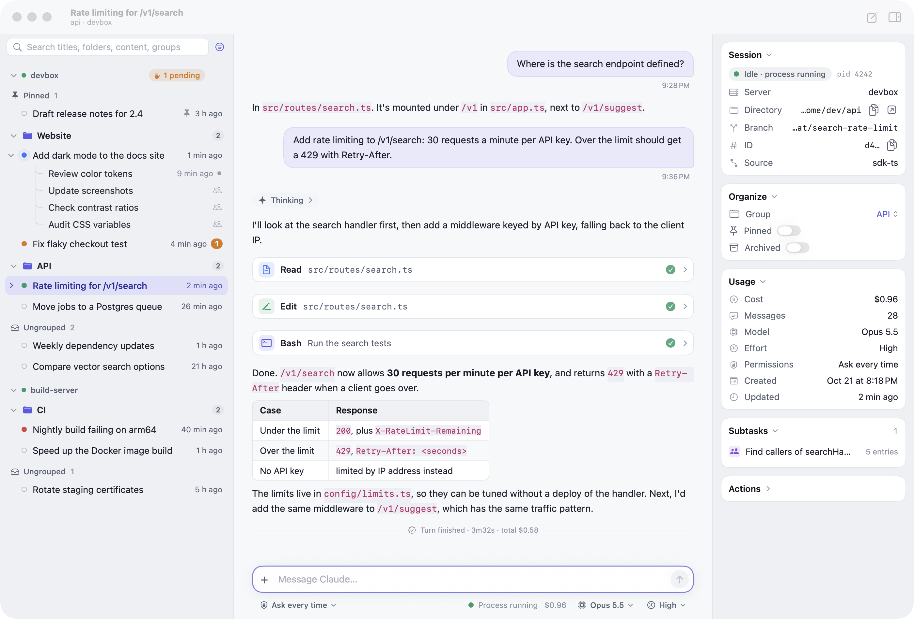

# Binary

A client/server tool for managing Claude Code sessions on your own machine or on servers.

- **binaryd** (server, TypeScript / Node.js): runs on the machine you want to manage (macOS / Linux). Every interaction with Claude Code goes through the **official Claude Agent SDK** (plus `claude agents --json`, which Claude Code provides for scripts): it doesn't modify Claude Code, doesn't implement internal protocols, and never touches your login credentials.
- **Binary.app** (client, SwiftUI, macOS 14+): connects to several servers at once to view and work with their sessions.
- **Binary for iOS** (client, SwiftUI, iOS 17+): the same client on iPhone and iPad, built from the same sources and installed from Xcode onto your own device (see [iPhone and iPad](#iphone-and-ipad)).



## Features

| | |
|---|---|
| Live view | Lists **all** Claude Code sessions on a machine (those created in Binary, and those opened from a terminal, an IDE or the desktop app), with live status; conversations stream in, including replies, thinking, tool calls and results |
| Sending messages | Continue any session: if no process is running it is resumed automatically (the SDK's `resume`); messages sent while Claude is busy are queued and handled when the current turn ends; you can interrupt at any time |
| New sessions | No dialog: a blank conversation opens on the right, and the session is created when you send the first message. It defaults to the project of your last new session and reuses that project's last branch, worktree, model, effort and permission mode (with worktree selected, each session gets its own). Before sending you can switch project or change these settings below the message box; the options icon on each entry in the project list edits its defaults and environment variables |
| Images | Paste, drop or attach images in the message box to send them to Claude; click images in the conversation to enlarge them |
| Model / Effort | Set per session; while the process runs, switching the model or a low–xhigh effort takes effect immediately, and `max` restarts the process automatically before the next turn (the session stays the same) |
| Groups and subagents | Sessions can be organized into groups (Claude Code session tags); sessions the Claude desktop app spawned from another session are nested under their parent; each session's subagents (Task / Agent tool) can be viewed on their own. "Ungrouped Sessions by Project" in the list's menu splits the sessions outside groups into one section per project folder on each server (sessions in a worktree under `.claude/worktrees` count as their repository's); a project's menu archives all its sessions at once |
| Session tools | In sessions Binary starts, Claude can use `get_session` / `set_session_title` to read and change the session title (same names and parameters as in the Claude desktop app), so project instructions that ask it to maintain the title still work |
| Permission approval | Approve tool permission requests in the client with Allow / Always Allow / Deny (with an optional reason); `AskUserQuestion` appears as a form of options, `ExitPlanMode` shows the plan for approval |
| Notifications | While Binary is in the background, it posts a system notification when a session needs approval, finishes or fails; the Dock icon badge shows the number of pending approvals |

## Quick start (local)

Requirements: Node.js 20+, Xcode command line tools (Swift 5.10+), and Claude Code signed in (`claude` works in your terminal).

```bash
make all
```

```bash
./server/bin/binaryd serve
```

`make server` runs `npm install` for the official Agent SDK, which bundles an official Claude Code matching the SDK version (about 220MB, installed per platform). binaryd uses it by default, sharing the same login and `~/.claude` configuration as the `claude` in your terminal. To use your own `claude` instead, set `claudePath` in `server.json`.

The first run creates `~/.binary/server.json` (with a random token, mode 0600). Then open the client:

```bash
open dist/Binary.app
```

The client reads `~/.binary/server.json` automatically and adds a server named "This Mac"; no manual setup needed.

To start the server at login (launchd on macOS, `systemd --user` on Linux; the current `PATH` is recorded so `claude` and the tools it calls can be found):

```bash
./server/bin/binaryd service install
```

Stop the running server before upgrading or rebuilding (`npm install` replaces dependencies it is using).

## Managing remote servers

1. Install Node.js 20+ and Claude Code on the server, and sign in using Claude Code's own flow: run `claude` once to log in; on headless machines, use `claude setup-token` to create a long-lived token and set it as the `CLAUDE_CODE_OAUTH_TOKEN` environment variable. Binary never reads or stores these credentials.
2. Deploy and install as a service (copies the source, runs `npm ci` on the server to install the platform's SDK and Claude Code, builds, installs the launchd / systemd service, and finally prints the token):

   ```bash
   server/scripts/deploy.sh devbox
   ```

   It installs to `~/binaryd` on the server by default; a second argument picks another directory. Run it again to upgrade. To keep it running after you log out, run `sudo loginctl enable-linger $USER` on the server.

3. Connect. By default the server only listens on `127.0.0.1:7350`. **The token is equivalent to shell access on that machine; never expose it to the internet over plain HTTP.**

   - **Tailscale (recommended)**: when both machines are on the same tailnet, use `tailscale serve` to give it an HTTPS address reachable only inside the tailnet (the certificate is issued by Tailscale, and binaryd still listens only locally; changing the serve config needs root, or run `sudo tailscale set --operator=$USER` first):

     ```bash
     sudo tailscale serve --bg --https 7350 http://127.0.0.1:7350
     ```

     Use `https://<machine>.<tailnet>.ts.net:7350` as the address in the client. To turn it off: `sudo tailscale serve --https=7350 off`.

   - **SSH tunnel**:

     ```bash
     ssh -N -L 7351:127.0.0.1:7350 devbox
     ```

     Use `http://127.0.0.1:7351` as the address in the client. If the tunnel drops (for example after the computer sleeps), set it up again.

   - Or serve HTTPS directly with `binaryd serve --listen 0.0.0.0:7350 --tls-cert cert.pem --tls-key key.pem`.

   Then in the client, go to "Settings → Servers → +", enter the address and token (printed by `binaryd token` on the server), click "Test Connection", then "Add".

## iPhone and iPad

`client/iOS` is an iOS 17+ app built from the same models, networking, stores and conversation views as the Mac client (those files compile for both platforms), with its own phone navigation, session list and settings. It isn't on the App Store: you build it and install it on your own device.

Requirements: Xcode with the iOS SDK, and [XcodeGen](https://github.com/yonaskolb/XcodeGen) (`brew install xcodegen`), which generates the Xcode project.

```bash
make ios                                # simulator build
client/scripts/build-ios.sh --device    # build, install and launch on the connected iPhone
```

To install on a device, sign in to Xcode with an Apple ID first (Xcode → Settings → Accounts; a free Personal Team works, but what it signs runs for 7 days, then install again), turn on Developer Mode on the phone (Settings → Privacy & Security), and the first time, trust the developer under Settings → General → VPN & Device Management. The script uses the first team Xcode knows and the first paired device; `BINARY_TEAM=<team id>`, `BINARY_IOS_BUNDLE_ID=<bundle id>` (default `dev.binary.ios.<team id>`) and a UDID after `--device` override them.

**Connecting.** binaryd listens only on `127.0.0.1` by default, which the phone can't reach, so give each server an address it can. Tailscale is the simplest (install it on the phone too); on the Mac or server:

```bash
sudo tailscale serve --bg --https 7350 http://127.0.0.1:7350
```

Then in the app, Settings → Add Server → Paste from Clipboard takes what `binaryd token` prints (with Universal Clipboard, copy it on the Mac); change the URL to `https://<machine>.<tailnet>.ts.net:7350` and Test Connection.

**How it differs from the Mac client:**

| | |
|---|---|
| Layout | Session list → conversation → subagent, as a navigation stack. Tap the title for the session menu (rename, child session, copy ID / resume command / directory, stop process); ⓘ opens the info panel as a sheet |
| Session list | The sidebar's sections: pinned, groups across servers, each server's sessions, with child sessions and subagents nested under the count at the end of a row; one line per session, plus what it's doing while it runs, waits or failed. Swipe right to pin, left to archive; long press for groups, rename and the rest; Show and Sort → Group Order… to drag groups into order; pull down to reconnect |
| Message box | Return inserts a new line; send with the button. + attaches from Photos or pastes an image from the clipboard. Permission mode, model and effort sit below it and scroll sideways |
| Background | iOS cuts an app's connections soon after it leaves the screen. For the short time it still runs (about 30 seconds), approvals, finished turns and errors notify as on the Mac; coming back reconnects and catches up. There are no push notifications |
| Not on iOS | Menu keyboard shortcuts, drag and drop, multiple selection, Finder actions; files linked in messages open in the preview sheet only |

The app keeps its settings, projects and cache in its own container, in the same files as the Mac client, separately from it.

## Using the client

### Layout
- The sidebar and the info panel on the right are ordinary split panes (not the system's floating panels); drag the dividers to resize them, and the widths are remembered. ⌘B shows / hides the sidebar.
- On the left is the session list (in sections by server), in the middle the conversation, on the right the session info panel (toggle with ⌥⌘I or the button at the right of the toolbar).
- The session title is in the toolbar; click it for an actions menu: rename, copy Session ID / resume command / working directory, stop process.
- Permission mode, model and effort are below the message box, collapsing into icons when the window is narrow.

### Appearance (Settings → Appearance)
- Language: English (default) / Chinese. Takes effect immediately; activity descriptions, errors and notifications from the server switch too.
- Style: Binary (default, cool gray with indigo) / Primary (colors and type settings based on the [Primary](https://github.com/primary-theme/obsidian) theme for Obsidian, using only its color values and style parameters; Inter / Cascadia Code are used automatically if installed).
- Mode: System / Light / Dark.
- Text size: Small / Medium (default) / Large / Extra Large, also adjustable with ⌘+ / ⌘- / ⌘0.

### Sidebar: status, groups, pinning, archiving, sorting
| Dot | Meaning |
|---|---|
| Pulsing | Running / starting |
| Orange badge | Waiting for approval or an answer (when a parent row is collapsed, its child sessions' pending approvals are counted on the parent) |
| Green | Idle, process still running (responds to messages immediately) |
| Gray | Idle, no process (resumed automatically when you send a message; takes a few seconds to start) |
| Pulsing purple | Another program (Claude desktop app, tmux, terminal, IDE) is running this turn |
| Red | The last start or run failed |

When another program has the session open but idle, or only background tasks (dev server, watcher) are left, it looks the same as a normal idle session; which program it is shows in the tooltip and under "Held by" in the info panel.

Each session takes a single row; activity descriptions and errors are in the tooltip and the info panel.

- **Server sections**: click a server header to collapse or expand it (⌥-click collapses all other servers; the context menu has "Collapse Others" and "Expand All"). A collapsed header still shows the session count, how many are running and how many await approval; opening a session in it expands it automatically, search still finds its sessions, and ⌥⌘↑ / ⌥⌘↓ skip collapsed servers.
- **Hiding duplicate copies**: the Claude desktop app syncs a copy of SSH sessions to the local machine, with the same session ID. When another online server has the same session, the local view-only copy is hidden and the session is shown under the server it actually runs on (even if it's view-only there too). The end of the section has a row "N copies hidden · Show", and the view menu has a matching toggle; copies reappear when that server goes offline. Opening a copy jumps to the session on the other server and keeps the parent/child links recorded by the desktop app.
- **Pinned and groups span servers**: at the top is "Pinned", then the groups, each holding sessions from all servers, with a small tag on each row naming its server (hidden when there is only one server). Groups with the same name are the same group; a group is still stored as a tag on the session's own server, so dragging a remote server's session into a group tags it on that server. The group order is kept on the servers (newer binaryd) so every client shows the same; collapsed state and newly created empty groups are saved locally; renaming and ungrouping apply to all servers. The "+" at the right of a group header creates a new session in that group, defaulting to the server and directory of the group's most recent session.
- **Server sections**: hold only sessions that are not grouped and not pinned.
- **Search** (⌘K, or ⌘F): matches titles, directories, content previews and group names.
- **Show and sort** (menu at the top right): Recent (activity in the last 3 days, running, awaiting approval or pinned) / All / Archived; sort by recent activity, creation time, title or project directory.
- **Groups**: a group is a session tag, stored on the server (written to the transcript), so every client sees it. Right-click "Move to Group", or drag a session onto a group header; drag it to "Ungrouped" to remove it. Right-click a group header to rename, move up / down, collapse or ungroup it, or drag headers to reorder; the "Organize" card in the info panel can change it too.
- **Pin, archive**: from the context menu or the toggles in the info panel. Kept on each session's server (newer binaryd), so the Mac and the phone show the same; the newest change wins, and what a client had pinned before its servers kept it is added to theirs. With older servers they stay on this client. Archived sessions only appear under "Archived", and temporarily return to the list when they have a pending approval.
- **Multiple selection**: ⌘-click or ⇧-click, then right-click to pin, archive or move to a group in bulk; you can also drag them together.

### Nesting: child sessions and subagents
- Rows with child sessions or subagents can be expanded, styled like the Claude desktop app: children are indented one level, joined to the parent with a thin line and a "╰" corner, with the status dot at the end of the row.
- Child sessions come from two places: "New Child Session" in Binary, and sessions the Claude desktop app spawned from another session (review rounds, for example).
- Child sessions and subagents are sorted by recent activity, with the relative time at the end of the row. When there are many subagents, only the latest 5 are shown by default, with a final row "Show all N subagents".
- Opening a subagent shows it read-only in the same view as the main conversation, refreshing every 3 seconds while the parent session runs (⌘R to refresh manually); "Back to Parent Session" returns. In the conversation, an expanded Task / Agent tool card has "Open Subagent Conversation".
- Jumping to a nested item from a notification, a Task card or "Back to Parent Session" expands the parent row and scrolls it into view.

### Sessions held by another program
- Binary can always keep talking in such a session: when it's idle (including when only background tasks are left), messages are sent directly. A hint above the message box says that to continue over there, first close and reopen it there (in tmux / a terminal, quit claude and resume), otherwise that side won't see the conversation from Binary.
- While the other side is running a turn, messages you send are queued and sent in order when that turn ends. Queued messages appear above the message box and can be cancelled with ✕; those sent from here can also be edited with ✏ (taken back into the message box).
- The menu next to the send button has "Fork and Continue Here": it makes a copy with the same directory, settings and group to continue in Binary, nested under the original session, leaving the original untouched.

### New sessions, projects, child sessions
- ⌘N creates a new session. At the top of the dialog is "Project"; clicking it opens the project list (modeled on the environment picker in the Claude desktop app): search, starred projects (⌥⌘1…9), projects listed by server, recently used directories, and finally "New Project…" (⌥⌘0). Hover over a row to star or edit it; starring a recent directory saves it as a project.
- A project = name + server + folder + branch + whether to use a worktree + environment variables, stored locally. When editing, pick the folder with the remote directory browser; branches come from the server's git info (branch and worktree are unavailable outside a git repository). "Delete Project" only removes the locally saved project, not the folder.
- The new-session dialog can also change the branch and worktree just for this session:
  - With worktree checked: creates a worktree at `<repo>/.claude/worktrees/<name>` on branch `claude/<name>`, branched from the selected branch (same as the Claude desktop app).
  - Without worktree but with another branch selected: first switches the directory to that branch; if the directory has uncommitted changes, the server refuses and explains why.
  - A directory not yet saved as a project can be saved with "Save as Project…".
- For sessions running in a worktree, the info panel shows the worktree path.
- "New Child Session…" in the sidebar context menu or under "Actions" in the info panel: inherits the parent's directory and group, and is nested under the parent once created.

### Images
- Add images with the "+" at the left of the message box, paste screenshots or copied images / image files with ⌘V, or drag images into the conversation area; thumbnails appear above the message box and can be removed one by one, up to 20 per message. The text can be empty when there are images.
- Images are downscaled locally before sending (long edge at most 2000px); PNGs over about 3.5MB are converted to JPEG; GIF / WebP up to 5MB are sent as is.
- Images in the conversation show as thumbnails; click to enlarge, then copy or "Open in Preview". The server caches images only in memory (48MB per session) and rereads them from the transcript after a restart; if they can't be read, "Image unavailable" is shown.

### View-only sessions
- Sessions the Claude desktop app runs on other machines over SSH (it mirrors their transcripts locally, so they appear in the list too), and sessions whose working directory no longer exists on this server, are view-only: the sidebar row has a marker at the end (a globe for SSH, an eye for a missing directory), the message box is replaced by a read-only note, and the info panel shows the location.
- To work with sessions on an SSH machine, deploy binaryd on that machine (see "Managing remote servers").

### Conversation
- Consecutive paragraphs, headings and lists within a message can be selected together by dragging; code blocks, quotes and tables are selected on their own.
- Links in messages that point to files (images, HTML, PDF, SVG, text; paths may be relative to the session directory) open in Binary's preview window, including files on remote servers; CSS, images and so on that an HTML file references from the same directory load too. Local files can also be opened with "Open in Default App" or "Show in Finder". Web links open in the browser as usual.
- Collapsed tool calls and thinking are a single line of faint small text, consecutive ones packed tightly together, so the main text is easier to read; click to expand into the full card.
- While a session runs, the view follows new content when you're at the bottom; scrolling up won't pull you back down, and "Latest" appears at the bottom right.
- Unsent text in each session's message box is kept across switching sessions and restarting Binary (attached images are kept only until Binary quits).
- Long conversations open with only the latest 60 messages fetched and rendered; click "Load earlier messages" at the top to load more, a chunk at a time.
- Local cache: recently opened conversations are saved locally and show instantly when reopened, with a small "Updating…" note at the top ("Offline · saved copy" when the server can't be reached); the server only sends what's new since the cache. Each server's session list and the images in conversations are cached too, so at launch the sidebar first shows the last list. Switching sessions on a slow remote server is almost instant.
- User messages are bubbles on the right; tool calls are expandable cards (Edit shows a diff, Bash the command and output, TodoWrite the checklist); Markdown supports headings, lists, quotes, copyable code blocks and tables.
- Completion notices for background tasks and agents appear as a single line (bell icon, red on failure); when there's a result, click to see it rendered as Markdown.
- Events injected by the Claude desktop app (updates from linked sessions, messages from other sessions, CI status, scheduled tasks) appear as a dimmed line, each with its own icon; click to see the body.
- Cards for permission requests, questions and plan approval stay pinned above the message box: Allow / Always Allow (adopting the rules Claude Code suggests) / Deny (with an optional reason); `AskUserQuestion` shows as options, `ExitPlanMode` shows the plan.

### Keyboard shortcuts
| Shortcut | Action |
|---|---|
| ↩ / ⇧↩ or ⌥↩ | Send / new line (while an input method is composing, ↩ still confirms the candidate) |
| ⌘N | New session |
| ⌘K / ⌘F | Search sessions |
| ⌘B | Show / hide sidebar |
| ⌥⌘↑ / ⌥⌘↓ | Previous / next session (↑ / ↓ also work when the sidebar has focus) |
| ⌥⌘I | Show / hide session info panel |
| ⌘. | Interrupt the current turn |
| ⌘↩ | Allow a permission request / submit an answer / approve a plan; create in the new-session dialog |
| ⌘R | Refresh subagent conversation |
| ⌘[ / ⌘] | Lower / raise effort |
| ⌘+ / ⌘- / ⌘0 | Bigger / smaller / default text size |

### Model, effort, permission mode

These affect only the current session. The model list comes from the server's Claude Code (fetched after any session first starts); you can also choose "Custom…" to enter any model ID or alias. "Default" means using Claude Code's own setting. While the process runs, switching the model or a low–xhigh effort takes effect immediately, and `max` restarts the process automatically before the next turn (the session stays the same).

- Click the effort below the message box to open the adjustment panel: the large text is the current level, colored on a gradient from blue at low to orange at max; the row below is the model, which opens the model menu; below that is a slider that snaps to the levels the server provides and commits on release. The ↺ at the top right restores "Default".
- With "Default", it shows what that actually is: below the message box and in the info panel it reads "Default · Medium" or "Default · Opus 5.5" (the effort and model actually in effect on the last turn), and the slider in the panel is dimmed at that level; before any turn has run, it reads just "Default" and the slider sits in the middle.
- Context and plan usage: below the message box is a context progress bar for the current session (turning to a warning color above 80%); "Usage" in the info panel has a full-width bar and token counts. At the bottom of the sidebar is the plan usage: two bars, for this week and the 5-hour window, showing by default the server of the selected session; the menu on the title can pin a particular server, and the button on the right opens usage and reset times for all servers. Context is known only after Binary has run a turn; plan usage comes from Claude Code's `/usage` data (marked experimental in the SDK, and hidden when unavailable).
- Process and background tasks: while a process is running, the "Process" section of the info panel lists what it's running in the background (background Bash commands, background subagents, monitors, workflows), each with a stop button, and below that you can stop the whole process; with no background tasks it says the process is idle and how soon it will close automatically. Clicking "N background tasks" or "Process idle" below the message box opens it too. ⌘. only interrupts the current turn and doesn't kill background tasks.
- ⌘[ / ⌘] (also in the Session menu) step one level at a time, stopping at low / max; starting from "Default", they step from the level actually in effect, or, if that's unknown, ⌘] goes to high and ⌘[ to medium. The new level briefly appears above the message box, and repeated presses commit only once after a 0.3-second pause.

| Permission mode | Description |
|---|---|
| Ask every time (default) | Tool calls that need permission are sent to the client for approval |
| Accept edits (acceptEdits) | File edits are approved automatically; everything else still needs approval |
| Plan mode (plan) | Read-only planning; submits a plan for approval when done |
| Auto-approve (auto) | Decided by Claude Code's classifier |
| Don't ask (dontAsk) | Actions not pre-authorized are denied outright |
| Bypass permissions (bypassPermissions) | Allows everything; can be disabled with `allowBypassPermissions: false` in `server.json` |

### Client local files

All under `~/Library/Application Support/Binary` (change the directory with `BINARY_CLIENT_DIR`): `servers.json` (server list and tokens, mode 0600), `appearance.json` (style, mode, text size, language, panel visibility), `drafts.json` (unsent draft text per session, 0600), `projects.json` (projects: name, server, folder, branch, worktree, environment variables, starred, last used), `sidebar.json` (sort order, filter, and per server: collapsed state, pinned, archived, group order, collapsed and expanded state; pinned, archived and the group order are also on the servers), `cache/<server id>/` (local cache, directory 0700 and files 0600, readable only by the current user: `transcripts/` with the latest 200 entries of each conversation, `sessions.json` with the last session list, and `images/`; capped at 200MB in total, evicting least recently used; the bottom of Settings → Servers shows its size, and "Clear Cache" empties it).

When connected to an older server (without the groups, child sessions or subagents APIs), the related UI is hidden automatically.

## Server configuration

`~/.binary/server.json` (change the directory with `--home` or `BINARY_HOME`):

| Key | Default | Description |
|---|---|---|
| `name` | hostname | Name shown in the client |
| `listen` | `127.0.0.1:7350` | Listen address; can be overridden temporarily with `--listen` |
| `token` | randomly generated | Access token (`Authorization: Bearer …`) |
| `claudePath` | bundled with the SDK | Use your own Claude Code install instead (compatibility not guaranteed if versions don't match) |
| `idleTimeoutMinutes` | `30` | How long a claude process may stay idle before it is reclaimed; `0` never reclaims; processes with background tasks running are not reclaimed |
| `allowBypassPermissions` | `true` | Whether `bypassPermissions` mode is allowed |
| `defaultPermissionMode` | `default` | Permission mode used when none is set for a session |
| `tlsCert` / `tlsKey` | empty | Enables HTTPS when both are set |
| `keepEnv` | empty | Extra `CLAUDE_CODE_*` environment variables passed through to claude |
| `desktopLinks` | `true` | Read parent/child sessions and SSH sessions from the Claude desktop app's session records (read-only, see below) |
| `desktopSessionsDir` | desktop app directory | Location of the desktop app's session records (on macOS defaults to `~/Library/Application Support/Claude/claude-code-sessions`) |

Activity descriptions and error messages from the server follow the client's `Accept-Language` request header (Chinese / English), defaulting to Chinese when it's absent.

Other commands: `binaryd token` (prints the address and token), `binaryd sessions` (lists local sessions), `binaryd service uninstall`.

## API

REST + SSE; see [docs/DESIGN.md](docs/DESIGN.md) for the full reference. For example:

```bash
curl -H "Authorization: Bearer $TOKEN" http://127.0.0.1:7350/api/v1/sessions
```

```bash
curl -N -H "Authorization: Bearer $TOKEN" http://127.0.0.1:7350/api/v1/sessions/$ID/events
```

## Development

```
server/       binaryd (TypeScript): src/ modules are described in docs/DESIGN.md "3.1 Modules"
              bench/ measurement scripts: SDK read time (session-read), event loop stalls (loop-lag, probe-stalls)
client/       Binary.app (SwiftUI, SwiftPM): Sources/Binary/{App,Models,Network,Stores,Views}
client/iOS/   the iOS app (XcodeGen project.yml): iOS-only Sources/, plus the shared files listed in project.yml
docs/         design docs
```

```bash
make test
```

Server tests (`node:test`) plug a fake Claude Code (`server/test/fake-claude.mjs`, which speaks the same protocol and writes transcripts in the same format) into the SDK's `pathToClaudeCodeExecutable`. They cover startup, streaming output, permission approval, merging live messages with the transcript, resuming after stop, the `max` effort restart, interrupts, live tracking of external sessions, renaming and groups, worktrees and environment variables, images, fork, session tools, as well as message format conversion, desktop session records, process holder detection and the "recent directories" rules, without calling the real API.

Development environment variables for the client (for checking the UI without screen recording permission; see `client/Sources/Binary/App/DebugHooks.swift`):

| Variable | Effect |
|---|---|
| `BINARY_CLIENT_DIR=<dir>` | Client config directory (avoids touching your real config during tests) |
| `BINARY_HOME=<dir>` | Directory where the local server config is auto-discovered (default `~/.binary`) |
| `BINARY_SELECT=<session id>` / `BINARY_SELECT_SERVER=<n>` / `BINARY_SELECT_AGENT=<agent id>` | Select a session (on the nth server) or one of its subagents after launch |
| `BINARY_NEW_SESSION=1` / `child` | Open the new-session dialog (child: as a child of the selected session) |
| `BINARY_SETTINGS=1` | Open the Settings window |
| `BINARY_SNAPSHOT=<file.png>` / `BINARY_SNAPSHOT_DELAY=<seconds>` / `BINARY_SNAPSHOT_QUIT=1` | Render each window to PNG (with a state summary in file.png.txt), then quit |
| `BINARY_WINDOW=<w>x<h>` | Main window size |
| `BINARY_FLAT=1` | Flat layout for screenshots (translucent material areas can't be captured) |
| `BINARY_SCROLL_TOP=1` / `BINARY_EXPAND_TOOLS=1` | Start the conversation at the top / expand tool cards by default |
| `BINARY_SET_LANGUAGE=en\|zh` / `BINARY_TOGGLE_INSPECTOR=1` / `BINARY_MOVE=<id>=<group>` | After launch, switch language / toggle the info panel / move a session into a group |
| `BINARY_ATTACH=<a.png,b.jpg>` | Put these images in the message box |
| `BINARY_PROJECT_PICKER=1` / `BINARY_EDIT_PROJECT=new\|current` | With `BINARY_NEW_SESSION`: open the project list / the project editor |
| `BINARY_TIMING=1` | Print timings of each stage of opening a session to stderr |
| `BINARY_SNAPSHOT_MODE=screen` / `composite` | Capture what's actually on screen (works with the split layout too) / composite popovers, sheets and the main window into one image |
| `BINARY_SEND_TEXT=<text>` | Type this text into the message box and press ↩ |
| `BINARY_KEYS=<steps>` | Send keys to the current input field in order, separated by `\|`: `⇧↩`, `↩`, `⇥`, `⌘[`, `⌘]`, `mark:<text>` (simulates input method marked text); anything else is typed as text |
| `BINARY_EFFORT_PANEL=1` | Open the effort adjustment panel after launch |
| `BINARY_PREVIEW=<path>` | With `BINARY_SELECT`: preview this file of the session |
| `BINARY_LOAD_OLDER=1` | Click "Load earlier messages" once, 2.5 seconds after opening a session |
| `BINARY_LOG=1` | Print the steps of sidebar expand-and-reveal and copy jumps to stderr |

The iOS app reads its own set (see `client/iOS/Sources/App/PhoneDebugHooks.swift`), passed with `SIMCTL_CHILD_<name>=… xcrun simctl launch <device> <bundle id>`: `BINARY_SELECT`, `BINARY_SELECT_SERVER`, `BINARY_SELECT_AGENT`, `BINARY_NEW_SESSION`, `BINARY_INFO=1` (info sheet), `BINARY_SETTINGS=1`, `BINARY_SET_LANGUAGE`, `BINARY_NO_NOTIFICATIONS=1`, `BINARY_SERVER` + `BINARY_TOKEN` (add a server), and `BINARY_SEND_TEXT`, `BINARY_EXPAND_TOOLS`, `BINARY_SCROLL_TOP` as above.

## Known limitations

- Sessions held by another program (Claude desktop app, terminal, tmux, IDE): you can't see their output as it streams, answer their permission requests, or interrupt a turn they're running. Binary can keep talking at any time (before sending, it restarts its own process if needed to pick up the other side's latest progress); but that program's process only remembers the version it read itself, so before continuing over there, close and reopen the session there, or the conversation will fork.
- The history API doesn't provide per-turn effort, cost or duration: the divider at the end of each turn comes only from live output, and the sidebar's last model and preview are available only after the session has been viewed or run by Binary.
- Large transcripts (hundreds of MB) are reread in full when they change, throttled by read time (measured: 0.2–0.4 seconds per read for 94–142MB), so they update less promptly than small sessions.
- Claude Code doesn't record parent/child relations between sessions. They come from two places: "New Child Session" in Binary, and the Claude desktop app's own session records (only five fields are read; this isn't a public interface, so if the desktop app changes its format, sessions simply stop being nested; turn it off with `desktopLinks: false`). Sessions started manually in a terminal have no parent/child relations.
- Sessions the Claude desktop app runs on other machines over SSH appear in the local list as mirrored transcripts and are view-only; so are sessions whose working directory no longer exists locally. To work with remote sessions, deploy binaryd on that machine and add it as a server; the local copies are then hidden automatically.
- The client is not signed (ad-hoc signature); if macOS blocks it on first launch, right-click it in Finder and choose "Open".
- The iOS app gets no push notifications: once iOS suspends it in the background, it catches up when it comes back. Signed with a free Apple ID, it has to be installed again every 7 days.

## License

[MIT](LICENSE)
